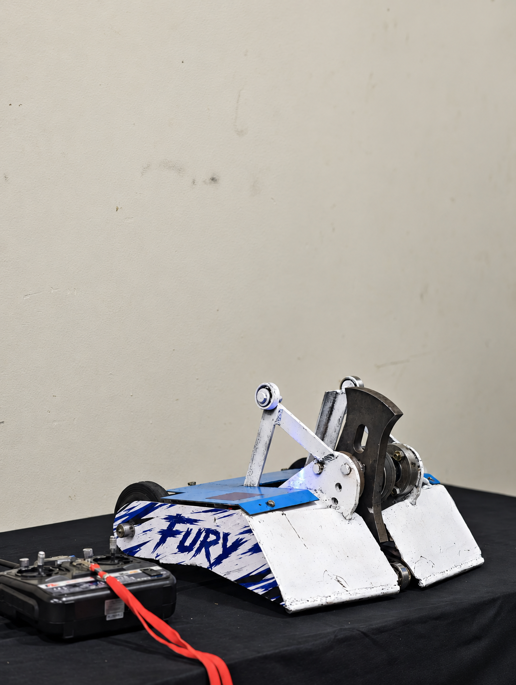
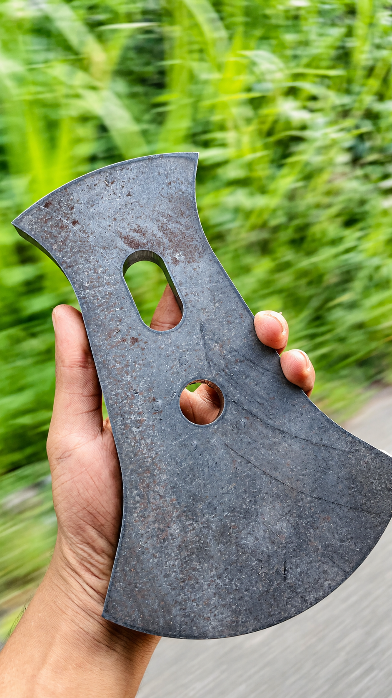
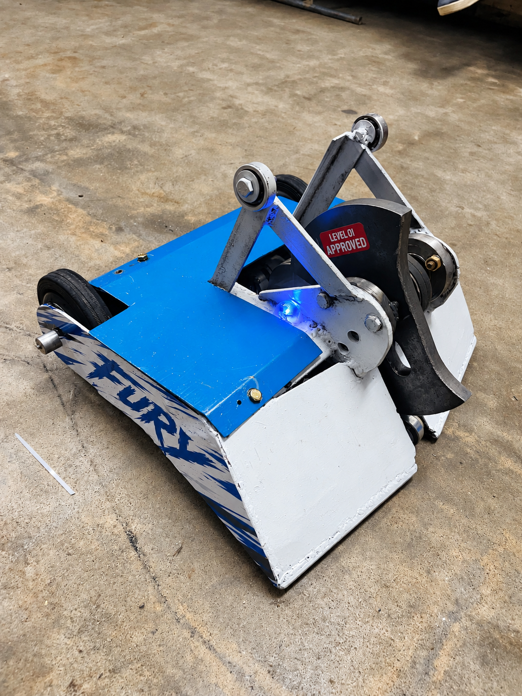

# ⚔️ FURY — 20 kg Combat Robot

  <strong>A competition-built combat robot engineered by Team Pulse for durability, control, and high-energy arena performance.</strong>

  

  <strong>🥉 3rd Place — Bot Bash 2026</strong>

---

## 📌 Overview

**FURY** is a 20 kg remote-controlled combat robot developed for **Bot Bash 2026**. The project brought together mechanical design, metal fabrication, drivetrain integration, radio control, electrical assembly, iterative testing, and fast pit-side problem solving.

The finished machine uses a compact armored chassis, a high-energy rotating weapon system, large traction wheels, and a reinforced front profile intended for aggressive arena operation. FURY earned **3rd place** with Team Pulse.

## ✨ Project Highlights

- ⚖️ 20 kg competition combat-robot platform
- 🌀 High-energy rotating weapon architecture
- 🎮 Radio-controlled drive and weapon operation
- 🛡️ Fabricated protective chassis and armor
- 🔩 Custom mechanical integration and assembly
- 🧪 Iterative workshop testing and refinement
- 🏟️ Competition-proven arena performance
- 🥉 3rd Place at Bot Bash 2026

## 🛠️ Engineering Scope

| Area | Contribution |
| --- | --- |
| **Mechanical design** | Packaging the drivetrain, weapon assembly, structure, and service access within the competition weight class |
| **Fabrication** | Cutting, welding, fitting, drilling, and finishing the chassis and protective bodywork |
| **Drive system** | Integrating high-torque mobility hardware for responsive arena control |
| **Weapon system** | Building and validating the rotating weapon assembly and its supporting structure |
| **Electrical integration** | Power distribution, radio-control hardware, motor control, and secure internal wiring |
| **Testing** | Functional checks, handling evaluation, reliability improvements, and competition preparation |

## 🏆 Competition Result

FURY represented **Team Pulse** at **Bot Bash 2026**, achieving **3rd place**. The result reflects the combined work of the team across design, fabrication, electronics, testing, operation, and repairs under competition conditions.

## 📷 Project Gallery

<table>
  <tr>
    <td colspan="2" align="center">
       
      <strong>Competition Robot</strong> Completed FURY platform with its radio controller.
    </td>
  </tr>
  <tr>
    <td width="50%" align="center">
       
      <strong>Weapon Component</strong> Fabricated rotating weapon profile.
    </td>
    <td width="50%" align="center">
       
      <strong>Workshop Build</strong> Completed machine during preparation and testing.
    </td>
  </tr>
</table>

### Selected videos

- 🎬 [FURY test run 01](assets/videos/fury-test-run-01.mp4)
- 🎬 [FURY test run 02](assets/videos/fury-test-run-02.mp4)
- 🎬 [FURY competition clip](assets/videos/fury-competition-clip.mp4)

The images are lightly enhanced for presentation, and the videos are web-optimized copies of the selected originals. No unselected media is included.

## 🧠 Engineering Areas

`Combat Robotics` · `Mechanical Design` · `Metal Fabrication` · `Welding` · `Radio Control` · `Motor Control` · `Power Electronics` · `Testing`

> **Safety note:** Combat robots contain high-energy moving components and powerful electrical systems. Operation and testing require suitable guarding, restraints, procedures, and trained supervision.

> **Design protection:** Editable CAD, dimensioned drawings, manufacturing files, fabrication templates, firmware, detailed wiring, component specifications, and other reproduction-ready materials are intentionally not published. This repository is a portfolio showcase, not an open-source hardware release.

---

## 👨‍💻 Developed by

**Theviru Lakwan — Team Pulse**  
Mechatronics Engineer · PCB Designer · IoT Developer · Entrepreneur

[LinkedIn](https://linkedin.com/in/theviru-lakwan-7758a41b8) · [GitHub](https://github.com/MrTheviru)

---

### Intellectual Property

© 2026 Theviru Lakwan and Team Pulse. All rights reserved.

This repository is provided for portfolio and demonstration purposes. No permission is granted to copy, modify, manufacture, distribute, sublicense, or commercially use the project designs, documentation, images, or other original materials without prior written permission from the rights holders.
